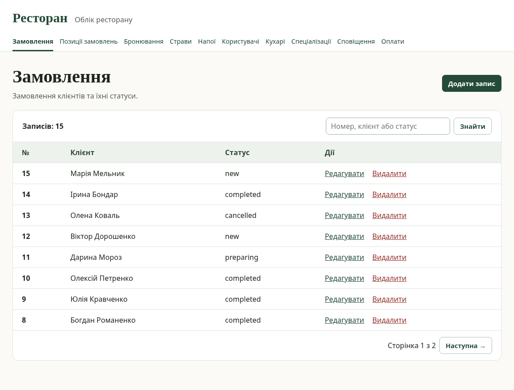
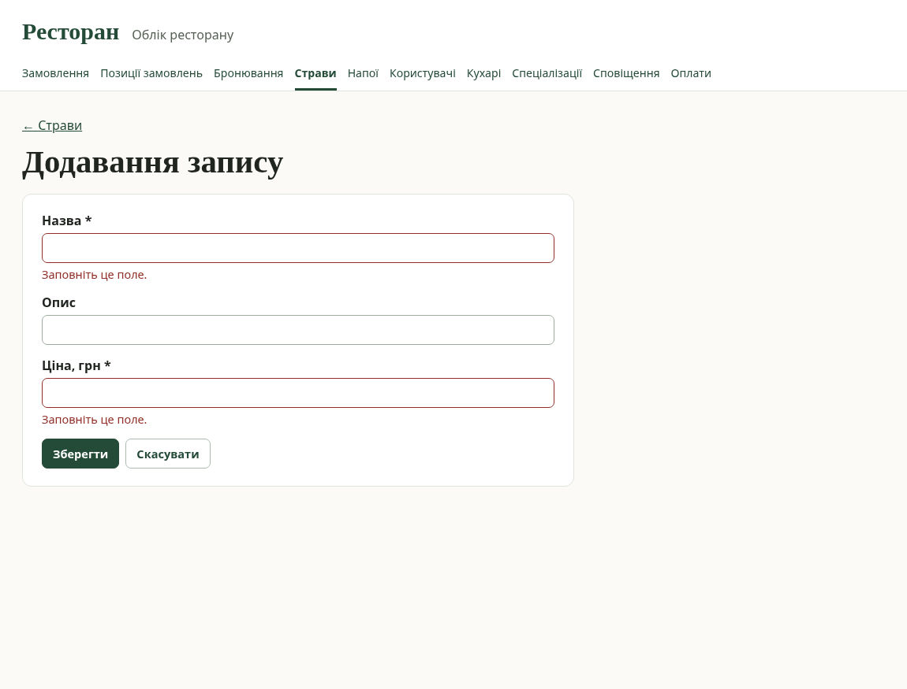
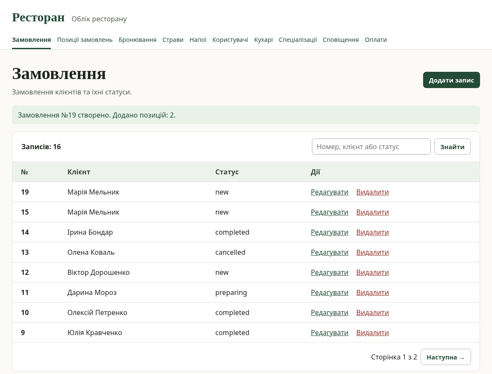

# Лабораторна робота № 4 — вебформи та взаємодія з БД

**Виконала:** Мазеїна Марина Олегівна, група КІ-251.  
**Дисципліна:** «Організація баз даних».  
**Предметна область:** інформаційна система ресторану (спільна схема ЛР № 1–3).

PHP 8.3 та Apache обслуговують вебформи. MySQL 8.4 зберігає дані ресторану. Apache публікує тільки каталог `public/`. Підключення до БД виконується через PDO з параметрами зі змінних середовища.

## Запуск у Windows

Відкрийте Docker Desktop і PowerShell у каталозі `lr4` (або в однойменному каталозі розпакованого архіву).

```powershell
Copy-Item .env.example .env
docker compose up -d --build
docker compose ps
```

Адреса сайту — [http://localhost:8080/](http://localhost:8080/). Якщо порт 8080 зайнятий, змініть `WEB_PORT` у локальному `.env` і відкрийте відповідний порт. Назва `restaurant_db` відповідає SQL-скриптам ініціалізації. У `.env.example` наведено демонстраційні значення для локального запуску. Compose виконає скрипти з `db/init/` у новому томі, після чого ті самі дані збережуться між запусками. Команда `docker compose down` зупиняє сервіси та зберігає том.

## Що реалізовано

| Розділ | Таблиця |
|---|---|
| Замовлення | `order` |
| Позиції замовлень | `order_item` |
| Бронювання | `reservation` |
| Страви | `food` |
| Напої | `drink` |
| Користувачі | `user` |
| Кухарі | `chef` |
| Спеціалізації | `chef_specialty` |
| Сповіщення | `notification` |
| Оплати | `transaction` |

- У кожному розділі можна переглядати, додавати, змінювати й видаляти записи. Пов’язані назви у списках отримуються через `JOIN`, а у формах використовуються випадаючі списки.
- Замовлення можна шукати за номером, клієнтом або статусом. Сторінка містить до восьми записів.
- Створення замовлення з вибраними стравою й напоєм виконується однією транзакцією. Для інших позицій доступний окремий розділ. Видалення запису, на який посилаються інші таблиці, завершується поясненням.
- Дані передаються через параметри підготовлених запитів. Вивід екранується. Форми перевіряють CSRF-токен, формат, обов’язковість і наявність FK. Успішний POST повертає 303 і повідомлення у списку.

## Сторінки застосунку

**Список замовлень**



**Перевірка форми**



**Створення замовлення з позиціями**


